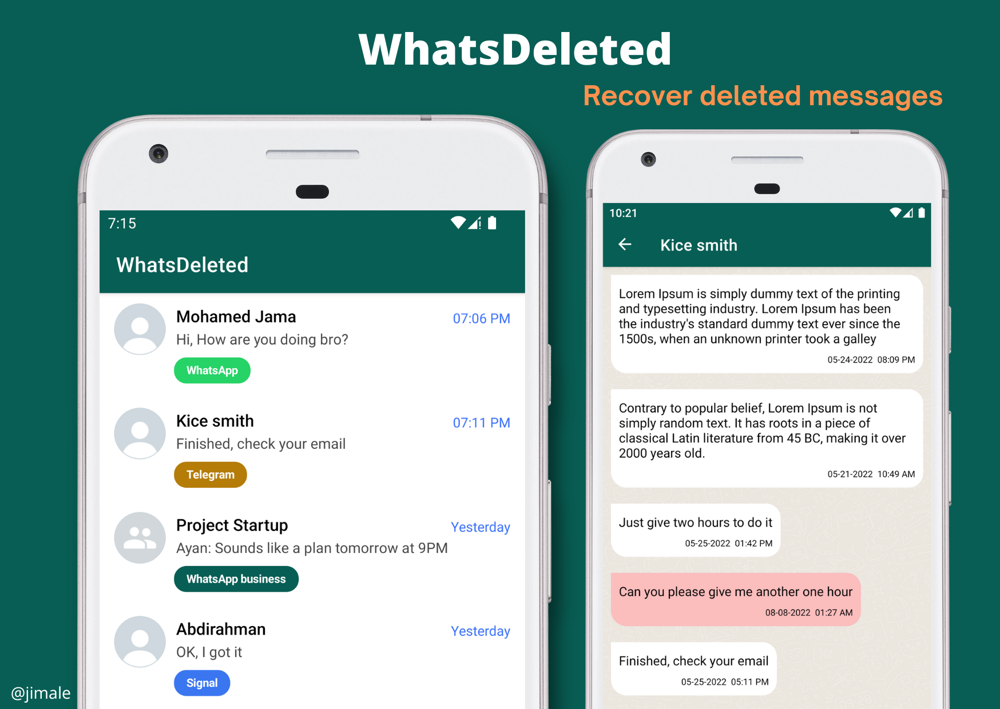

# 🗑️ WhatsDeleted

<p align="center">
  
</p>

**WhatsDeleted** is an Android app that recovers deleted WhatsApp / WhatsApp Business / Telegram / Signal messages by reading the system notifications those apps post, storing them locally, and flagging the ones that get retracted — so you can read what was deleted.

[](https://developer.android.com)
[](https://kotlinlang.org)
[](https://developer.android.com)
[](https://developer.android.com)
[](LICENSE)

---

## ✨ Features

- 💬 **Message recovery** — captures incoming WhatsApp, WhatsApp Business, Telegram, and Signal notifications before they're deleted
- 🔔 **Deletion alerts** — gets a local heads-up notification the moment a message is retracted, and tapping it jumps straight into that chat
- 👥 **Group & direct chats** — detects group senders and names the originating app with a colored badge
- 🗂️ **Organized history** — conversations grouped by contact, messages grouped by date, with timestamps
- 🔒 **100% local** — everything is stored in a private on-device Room database; no cloud, no third-party servers
- 🎨 **Edge-to-edge modern UI** built with the Navigation Component

## 🧠 How it works

1. **Notification capture** — a `NotificationListenerService` filters system notifications to the four supported apps and stores the sender (`title`) and message body (`text`) in a local **Room** database before the app can retract them.
2. **Deletion detection** — when a messaging app retracts a message it posts a *"This message was deleted"* notification; WhatsDeleted matches it to the last stored message for that chat and marks it as deleted.
3. **Notify & jump** — a local heads-up notification tells you something was deleted; tapping it deep-links into that conversation's detail screen.

> ⚠️ **Note:** Deletion detection is **best-effort, not guaranteed** — WhatsApp doesn't always re-post a deletion notice for every message anymore. But since every incoming notification is captured and stored as it arrives, the original message is usually already waiting for you in WhatsDeleted when you notice it vanish.

## 🛠 Tech Stack

| | |
|---|---|
| **Language** | Kotlin |
| **Architecture** | Single-module MVVM with Hilt dependency injection (`@HiltViewModel`, `@AndroidEntryPoint`) |
| **Storage** | Room database (schema v3, exported + migrated) |
| **UI** | ViewBinding, Navigation Component, edge-to-edge layouts |
| **Core service** | `NotificationListenerService` |
| **Crash reporting** | Firebase Crashlytics (release builds only) |

## 🚀 Getting Started

### Build from source

1. Clone the repository
   ```bash
   git clone https://github.com/awaisdev5765/WhatsDeleted.git
   ```
2. Open it in **Android Studio** (Gradle 8.x, JDK 17+)
3. Add your own `google-services.json` (Firebase) — it's gitignored and required to compile
4. Run on a device or emulator with **Android 6.0 (API 23)+**

### Using the app

1. Open WhatsDeleted and walk through the intro
2. Grant **notification access** when prompted (this is the app's core permission — no messages can be captured without it)
3. Optionally allow **notifications** on Android 13+ so deletion alerts appear
4. That's it — messages start appearing in the chat list

## 📂 Project Structure

```
app/src/main/java/com/tiriig/whatsdeleted/
├── data/
│   ├── model/        # Room entity + projections
│   ├── database/     # Room database, DAO, migrations
│   └── repository/   # ChatRepository (only DAO access point)
├── di/               # Hilt modules
├── services/         # NLService — the notification listener
├── ui/
│   ├── main/         # Splash + MainActivity
│   ├── intro/        # First-run AppIntro flow
│   └── chat/         # Chat list & detail screens
└── utility/          # Extensions & helpers
```

## 🤝 Contributing

Contributions are welcome! Open an issue or submit a pull request.

## ☕ Support

If this project helps you, please consider supporting my work:

<p align="center">
  <a href="https://buymeacoffee.com/awaisdev572">
    
  </a>
</p>

Or [become a supporter on Buy Me a Coffee](https://buymeacoffee.com/awaisdev572) 💛

## 📄 License

Released under the [Apache License 2.0](LICENSE).

---
> **Disclaimer:** WhatsDeleted is not affiliated with WhatsApp, Telegram, or Signal. All trademarks belong to their respective owners. The app only reads notifications it is granted access to on your own device and stores them locally.
